## Background + Steps 

For the first 4 figures, I used the Healy chapter to follow the code and packages to make the graphs, which were straight forward. Then, for Figures 5 and 6 I had to use and upload the new data from the midterms and created a winners26 variable that grouped by state and race and then mutating the winners writing so it types out the way I want. Similar to the Healy code, I made separate DataFrames. For Figures 7 and 8, I had to make a margins26 variable that not only grouped states, but had to look at the votes_pct to see the amount of weight and change in the votes. I then had to join with that new variable made, into the winners26 one. I then mutated this information to make a new variable for the Republican margin subtracted by the Republican points. Now, for Figure 9, I started with making a tibble of where SU is including its longitude and latitude. Then, I had to build a star but making variables with the angles, radii, and to include the tibble with all the map. I had to research a lot about how to do it. Then using the same packages as before, I was able to use the same maps. I'm from Texas, so I'm very familiar with the tornadoes and it's something I've dealt with all my life. I first loaded the data and filtered out the years and to exclude Alaska, Hawaii, Puerto Rico, and Virgin Islands. I wanted to just focus on the US. Then I made the maps of the US and Texas counties to use later. Then I had to reference Coordinate Reference Systems (CRS) and the EPSG codes, the numbers represent the longitude/latitude which is how tornado coordinates are recorded, the US map, and the Texas counties map. Then I was able to plot this information. Then for the Texas counties, I had to mutate the information to get the TX counties with the area square mile variable. Then I had to join and merge the information  with the variables by the ID. Then, finally I had to join the data for the Texas map with area square miles. 

## Figure 1: 2024 Election Winner by State
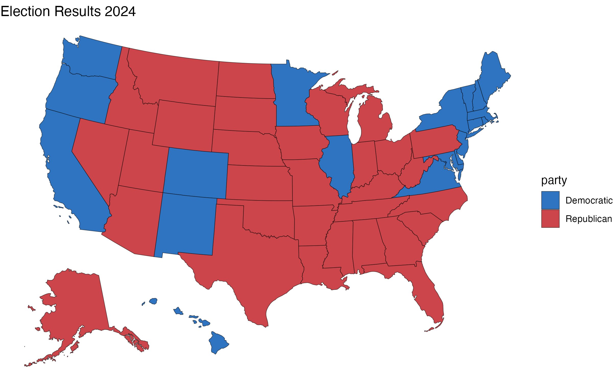{fig-align= "center" width="70%"}

This US map represents the 2024 election results by who won in each state, the Democratic candidate or Republican Candidate. 

## Figure 2: 2024 Election Winner by County
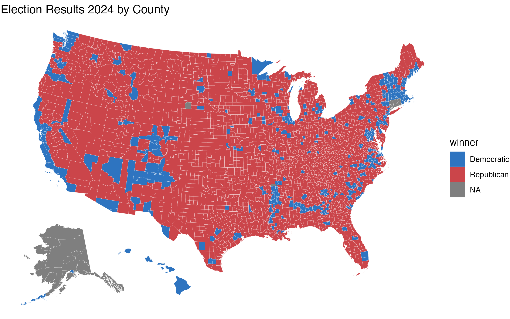{fig-align= "center" width="70%"}

This US map represents the 2024 election results by each county, in each state, the Democratic candidate or the Republican candidate.

## Figure 3: Population Density by Counties  
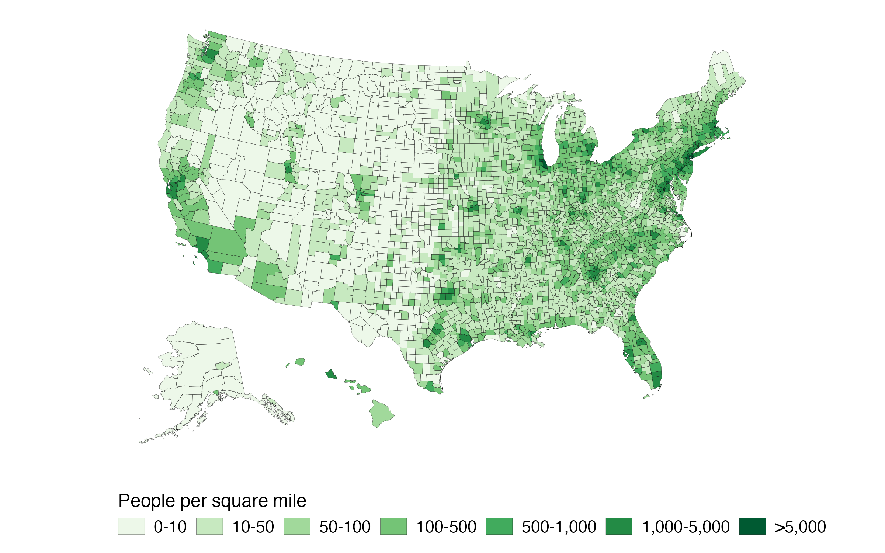{fig-align= "center" width="70%"}

This map represents the Population Density by counties across the US. 

## Figure 4: % Black by County 
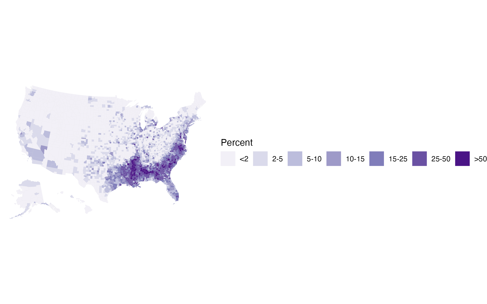{fig-align= "center" width="70%"}

This map represents the % of Black population by counties across the US.

## Figure 5: 2026 Senate Winner
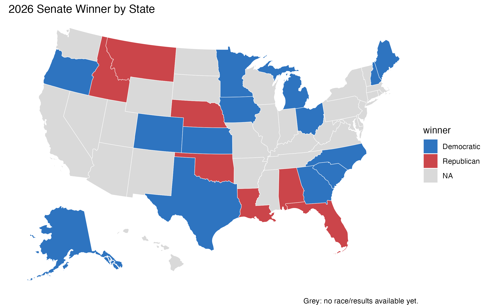{fig-align= "center" width="70%"}

This graph represents the winners in the 2026 midterms for the Senate. The blue represents a Democratic winner, the red represents if there was a Republican winner, and the grey represents "NA" meaning either the state didn't hold a midterm, or there weren't results yet. For example, the Mississippi Race for Senator was just called on November 11. 

## Figure 6: 2026 Governor Winner
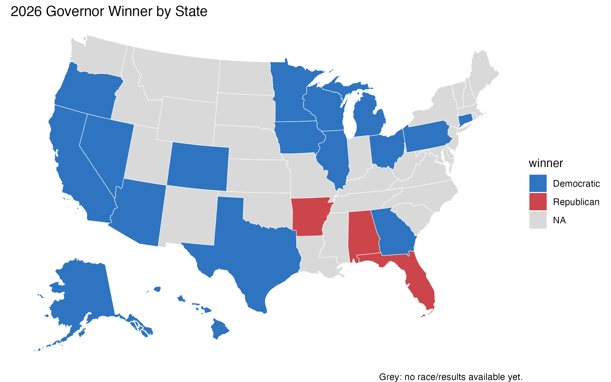{fig-align= "center" width="70%"}

This graph represents the winners in the 2026 midterms for the Governor The blue represents a Democratic winner, the red represents if there was a Republican winner, and the grey represents "NA" meaning either the state didn't hold a midterm, or there weren't results yet.

## Figure 7: 2026 Senate Swing
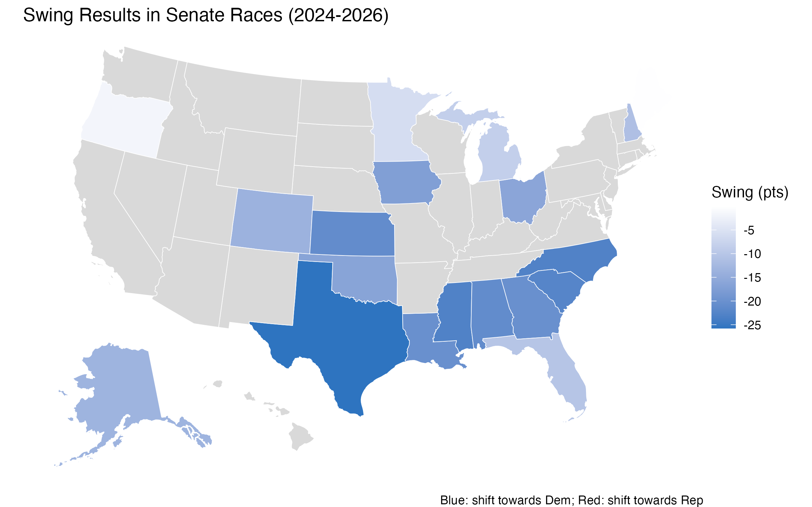{fig-align= "center" width="70%"}

This graph represents how much swing and vote percentage points from the 2024 election to the 2026 midterms for Senate. We see that the biggest changes happen from Texas for Democratic swing. 

## Figure 8: 2026 Governor Swing
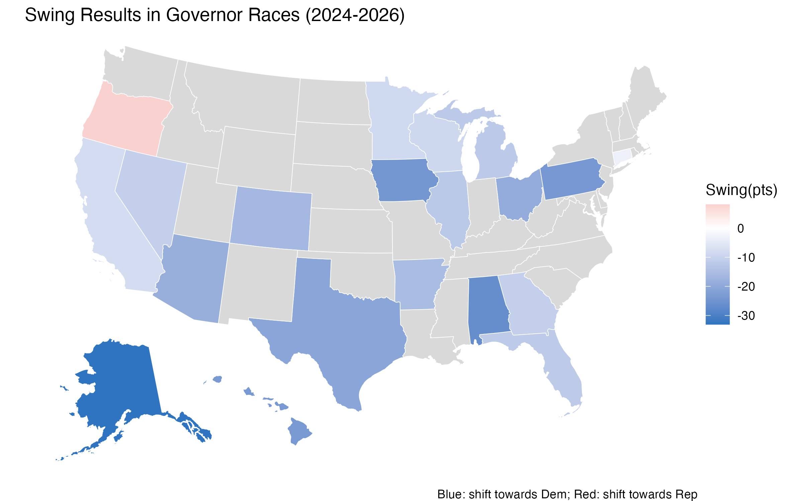{fig-align= "center" width="70%"}

This graph represents how much swing and vote percentage points from the 2024 election to the 2026 midterms for Governor. We see that the biggest changes happen from Alaska for a Democratic swing. 

## Figure 9: SU Location on US Map
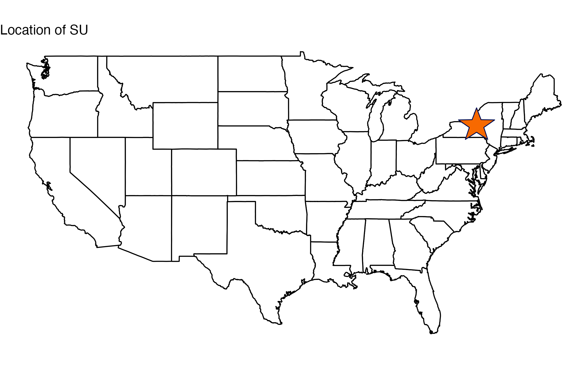{fig-align= "center" width="70%"}

This graph represents where SU is on a map of the US. 

## Figure 10: Significant Tornadoes Across the US, 2000-2023 
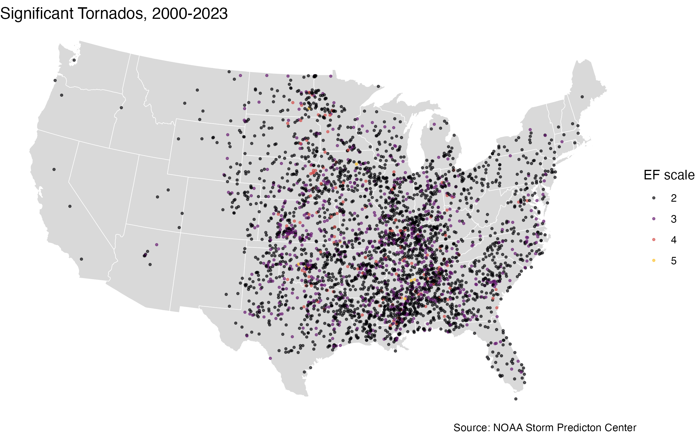{fig-align= "center" width="70%"}

This graph represents the amount of tornadoes that happened across the US, from 2000-2023. The colors represent the type of tornadoes and the scale of them. The Enhanced Fujita (EF) scale is used to measure the intensity and severity of a tornado based on the damage it left behind. The data was procured from NOAA (https://www.spc.noaa.gov/). 

## Figure 11: Tornado Frequency Across Texas Counties, 2000-2023
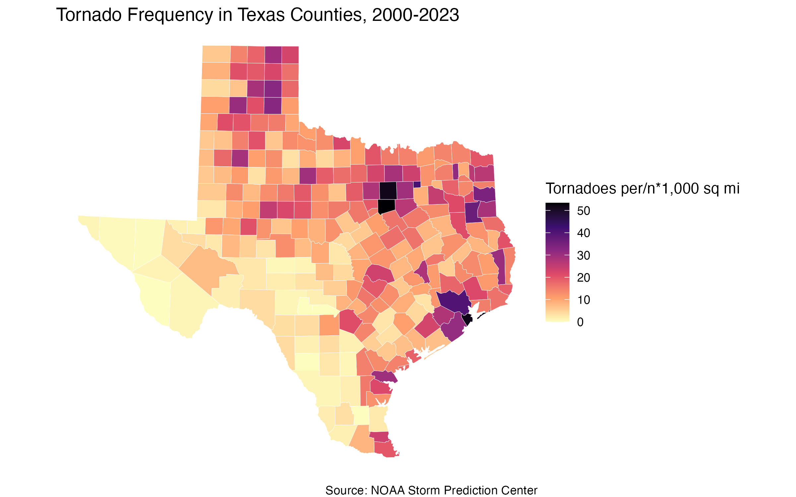{fig-align= "center" width="70%"}

This graph represents the amount of tornadoes that happen across Texas counties and how frequent, from 2000-2023. The colors and scale on the right, represents the amount of tornadoes per square mile, because that it is how the data is formatted.